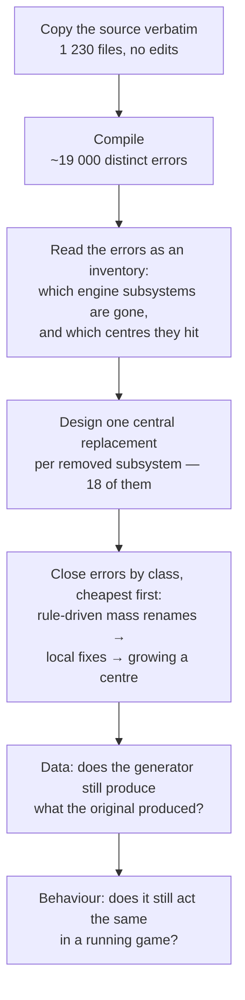

# How GregTech 6 was ported

[← README](README.md)

## Why porting it is hard

GregTech 6 was written for Minecraft 1.7.10 (2014). Between that version and 1.20.1 essentially every
engine subsystem the mod depends on was removed or replaced — not deprecated, removed:

| What GT6 uses in 1.7.10 | What happened to it |
|---|---|
| Item metadata (`ItemStack` = item + damage value) | gone; item identity is now item + data components |
| Block metadata (0–15 per position) | gone; a block is a single block state |
| The block `Material` system (stone / wood / metal…) | removed as a concept |
| Immediate-mode rendering (`IIcon`, `Tessellator`, GL calls, TESRs) | removed; everything is baked models now |
| Forge's `OreDictionary` | removed |
| `IWorldGenerator` (imperative world generation) | replaced by data-driven features and biome modifiers |
| The fluid system (`Fluid`, `BlockFluidClassic`) | split apart and rebuilt |
| The networking layer (`SimpleNetworkWrapper`) | replaced |
| Vanilla crafting registration from code | removed; recipes are datapack JSON |
| The coremod / bytecode-transformer entry point | removed |
| GUI handling (`IGuiHandler`, `Container`, `GuiScreen`) | replaced |
| Achievements | replaced by advancements, with different side effects |

A mod that merely *uses* Minecraft can absorb that kind of change subsystem by subsystem. GT6 cannot,
for a structural reason: it is a **monolith**. Its defining property — and the reason it scales to
hundreds of materials without collapsing — is that the conversation with the engine happens in *one*
place. One module talks to the world, one to item stacks, one to NBT, one to the ore dictionary, and
the entire mod goes through them, always. A dependency graph of the source shows 272 of its classes in
a single strongly connected component: a knot that cannot be cut into independently portable slices.

So the port has no "start with a small feature and grow" path available. Either the foundation stands
up as a whole, or nothing runs.

## The architecture that had to survive

GregTech 6 is roughly 200 000 lines across ~1 230 classes, but size is not what makes it hard. Two
structural properties decide everything about how it can be ported.

**It is a generator, not a catalogue.** The mod declares ~407 materials and ~453 prefixes — shapes
such as ingot, dust, small gear, double plate — and derives the rest: items and blocks, ore dictionary
entries, textures, names, tooltips, ~196 fluids, and recipes across ~85 machine types. A material
carries its composition, hardness, melting point, by-products and tool quality; the generator reads
those and produces the world of the mod at load time. Port the output and you get a snapshot that
cannot grow. Port the generator and everything derived from it follows.

**It talks to the engine in one place per subject.** This is what makes GregTech 6 unusual, and the
reason porting it is possible at all:

| Centre | Owns |
|---|---|
| world access | every read and write of blocks, positions, metadata, tile entities |
| item stacks | creation, comparison, size, identity, "is this empty" |
| NBT | reading and writing, including the quirks of wrongly-typed keys |
| ore dictionary | registration, lookup, unification targets |
| materials and prefixes | the generator matrix itself |
| mod presence | whether another mod is installed, asked the same way in ~120 places |
| constants and flags | shared configuration the whole mod reads |
| machine registry | machines are *registry entries with parameters*, not classes — thousands of them from a few dozen behaviours |

Nothing bypasses these. When the engine removed block metadata, the port did not touch the ~1 200 call
sites that read it: the world-access centre changed internally, and the call sites stayed byte-for-byte
what Gregorius wrote.

**The consequence: it cannot be sliced.** A dependency graph of the source puts 272 classes in a single
strongly connected component. There is no "start with the boiler and grow" path — the foundation stands
up whole or nothing runs. That ruled out the usual incremental strategy before the first line was moved.

## How the port was executed

Copying 200 000 lines onto an engine that cannot compile them is a deliberate first move: the resulting
error list is an inventory produced by the compiler rather than by anyone's opinion about what probably
needs attention. Every disagreement between the two engines, enumerated, countable and shrinking as
work proceeds. The seams came out of that list crossed with the dependency graph, not out of a feature
wishlist.

Errors were then closed **by class, never by file**. "This call was renamed" is a rule that applies to
five hundred sites at once and can be applied mechanically; "this file is broken" is five hundred
separate judgement calls. When a class of errors could not be closed by a rule, that was the signal
a real seam had been found and a centre had to grow.

Work that could not be finished on the spot was marked in the code and counted by a script. That
counter is the honesty gauge of the effort: it went 43 → 28 → 23 → 10 → 7 → 5 → 0, and CI checks it on
every push so new deferrals stay visible instead of quietly accumulating.

## The eighteen seams

Places where the original construct has no counterpart at all. Each is one central replacement, not
a family of local workarounds:

| Removed in the modern engine | Replacement |
|---|---|
| item metadata | one item per shape + a material data component |
| coremod bytecode transformation | mixins over the same methods the original patched, plus access transformers |
| immediate-mode rendering | baked models driven by GT6's own texture layer; connection-dependent shapes via model data |
| Forge's ore dictionary | GT6's own registry — it already maintained a richer layer above Forge's |
| the fluid system | fluid data kept as is; world fluids re-parented onto the engine's liquid block so vanilla interactions (freezing, sponges, buckets, lava meeting water) work again, while GT6's finite-quantum flow is preserved |
| imperative world generation | the original vein and layer algorithms wrapped as engine features, placed by biome modifiers |
| the networking layer | the same packets over the modern payload API |
| raw NBT as the data channel | a bridge preserving the original keys and semantics, quirks included |
| the block material system | 1.7.10's categories rebuilt as traits, plus one bridge into modern block properties |
| `@Optional` cross-mod compatibility | the mod-presence centre retained; foreign APIs mirrored at compile time only |
| code-registered crafting recipes | procedural generation into GT6's own recipe buffer, exposed through a single dispatcher |
| the FML mod lifecycle | the mod's own lifecycle centre untouched; only the outermost entry points are modern |
| block position metadata | world-access centre keeps the old signatures; own blocks carry extended metadata |
| the GUI stack | one menu provider, one menu type, original routing preserved |
| `null` as "empty item" | GT6 keeps its own model internally; conversion happens at an enumerated set of engine boundaries |
| mandatory block codecs | one central stub — GT6 blocks are procedural, never data-driven |
| the NBT read API | read helpers centralised, preserving 1.7.10's wrong-type behaviour |
| achievements | a no-op: the modern award carries side effects the original never had |

## How correctness is judged

The original is not documentation to be read — it is a **reference implementation you can run**. A
1.7.10 installation is kept instrumented: it is asked what it does, the port is asked the same question
the same way, and the answers are compared.

| Level | Question it answers |
|---|---|
| Compiler | does it exist and link |
| Comparison against the original | does the generator still produce the same materials, items, ore dictionary entries, recipes, worldgen definitions and names |
| In-engine probes | does the real engine path behave the same — which block actually got placed, what actually ended up in the slot, what the machine actually consumed and produced |
| Side-by-side measurement | for behaviour that exists only while running — fluid spreading, machine timing — the same instrument is compiled into *both* versions and one scenario is run in each |
| Playing the game | everything the instruments cannot see |

Two rules keep this from lying, both bought with failures:

* **A comparison is only as good as its scope.** Matching data proves the generator's *output* matches.
  It says nothing about whether the result reaches the player: an item can be correct in every registry
  and still be invisible, unobtainable or wrongly rendered.
* **A check that cannot fail is not a check.** Every comparison is run once in a state where it is
  known to be broken, to confirm it can see the difference at all.
